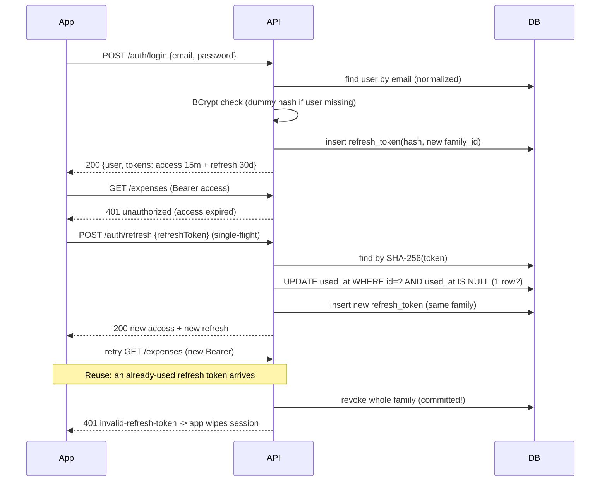

# Authentication flow

Design and reasons: ADR 0002 (refresh tokens) and ADR 0004 (JWT validation) in
`docs/decisions/`. Endpoints, payloads and errors: `docs/api-contract.md` → Auth.
This skill shows how the API implements them. If real code diverges, the code wins.
Report the divergence so the skill gets updated.

## The flows at a glance



## Schema

```sql
-- V1__create_users.sql
create table users (
    id            uuid         primary key,
    name          varchar(80)  not null,
    email         varchar(254) not null,
    password_hash varchar(72)  not null,      -- BCrypt output is 60 chars
    currency      char(3)      not null default 'BRL',
    created_at    timestamptz  not null
);
create unique index uq_users_email on users (lower(email));

-- V2__create_refresh_tokens.sql
create table refresh_tokens (
    id          uuid        primary key,
    user_id     uuid        not null references users (id) on delete cascade,
    family_id   uuid        not null,
    token_hash  char(64)    not null unique,  -- hex SHA-256; raw token never stored
    expires_at  timestamptz not null,
    used_at     timestamptz,
    revoked_at  timestamptz,
    created_at  timestamptz not null
);
create index idx_refresh_tokens_family on refresh_tokens (family_id);
create index idx_refresh_tokens_user   on refresh_tokens (user_id);
```

## Configuration: fail fast without a strong secret

```java
@ConfigurationProperties("app.security.jwt")
@Validated
public record JwtProperties(@NotBlank String secret,
                            @NotBlank String issuer,
                            @NotNull Duration accessTokenTtl) {

    public JwtProperties {
        if (secret != null && !secret.isBlank()
                && Base64.getDecoder().decode(secret).length < 32) {
            throw new IllegalArgumentException("JWT_SECRET must be base64 and at least 256 bits");
        }
    }

    public SecretKey key() {
        return new SecretKeySpec(Base64.getDecoder().decode(secret), "HmacSHA256");
    }

    @Override
    public String toString() { return "JwtProperties[issuer=" + issuer + ", secret=****]"; }
}
```

Same pattern for the refresh token TTL, never `@Value` on a field:

```java
@ConfigurationProperties("app.security.refresh-token")
@Validated
public record RefreshTokenProperties(@NotNull Duration ttl) {}
```

Enable with `@ConfigurationPropertiesScan` on the application class.
An empty `JWT_SECRET` fails `@NotBlank`, so the application does not start.

## SecurityConfig

```java
@Configuration
@EnableWebSecurity
@RequiredArgsConstructor
public class SecurityConfig {

    private final JwtProperties jwt;
    private final ProblemDetailAuthenticationEntryPoint entryPoint;   // writes 401 ProblemDetail
    private final ProblemDetailAccessDeniedHandler accessDenied;      // writes 403 ProblemDetail

    /**
     * Chain 1 (ADR 0005): public auth endpoints WITHOUT the JWT filter.
     * A stale or expired "Authorization" header is ignored, so logout/refresh always work.
     */
    @Bean
    @Order(1)
    SecurityFilterChain authEndpoints(HttpSecurity http) throws Exception {
        return common(http)
                .securityMatcher("/api/v1/auth/**")
                .authorizeHttpRequests(auth -> auth
                        .requestMatchers(HttpMethod.POST,
                                "/api/v1/auth/register", "/api/v1/auth/login",
                                "/api/v1/auth/refresh", "/api/v1/auth/logout").permitAll()
                        .anyRequest().denyAll())                         // unlisted auth paths fail closed
                .build();                                                // no oauth2ResourceServer() here
    }

    /** Chain 2: everything else requires a valid access token (ADR 0004). */
    @Bean
    @Order(2)
    SecurityFilterChain api(HttpSecurity http) throws Exception {
        return common(http)
                .authorizeHttpRequests(auth -> auth
                        .requestMatchers("/docs/**", "/v3/api-docs/**").permitAll() // can be disabled in prod
                        .anyRequest().authenticated())
                .oauth2ResourceServer(o -> o
                        .jwt(Customizer.withDefaults())
                        .authenticationEntryPoint(entryPoint))
                .build();
    }

    /** Settings shared by both chains. */
    private HttpSecurity common(HttpSecurity http) throws Exception {
        return http
                .csrf(AbstractHttpConfigurer::disable)                  // no cookie auth
                .cors(Customizer.withDefaults())                        // CorsConfigurationSource bean, explicit origins
                .sessionManagement(s -> s.sessionCreationPolicy(SessionCreationPolicy.STATELESS))
                .exceptionHandling(e -> e
                        .authenticationEntryPoint(entryPoint)
                        .accessDeniedHandler(accessDenied));
    }

    @Bean
    JwtDecoder jwtDecoder() {
        var decoder = NimbusJwtDecoder.withSecretKey(jwt.key())
                .macAlgorithm(MacAlgorithm.HS256)                       // pin the algorithm
                .build();
        decoder.setJwtValidator(JwtValidators.createDefaultWithIssuer(jwt.issuer())); // exp + iss
        return decoder;
    }

    @Bean
    JwtEncoder jwtEncoder() {
        return new NimbusJwtEncoder(new ImmutableSecret<>(jwt.key()));
    }

    @Bean
    PasswordEncoder passwordEncoder() {
        return new BCryptPasswordEncoder();
    }
}
```

Public endpoints are listed one by one. Everything else is `authenticated()`. Never merge
the two chains: with one chain, `BearerTokenAuthenticationFilter` rejects an expired token
**before** `permitAll()` is evaluated, and logout/refresh break (ADR 0005).

## Current user: the only way to get a user id

```java
@Target(ElementType.PARAMETER)
@Retention(RetentionPolicy.RUNTIME)
@AuthenticationPrincipal(expression = "T(java.util.UUID).fromString(subject)")
public @interface CurrentUserId {}
```

`@AuthenticationPrincipal` works as a meta-annotation. The principal is the validated
`Jwt`, and `subject` is its `sub` claim (the user UUID). Controllers declare
`@CurrentUserId UUID userId` and never accept a user id from the request.

## Issuing the access token

```java
@Service
@RequiredArgsConstructor
public class AccessTokenService {

    private final JwtEncoder encoder;
    private final JwtProperties props;
    private final Clock clock;

    public String issue(UUID userId) {
        var now = clock.instant();
        var claims = JwtClaimsSet.builder()
                .issuer(props.issuer())
                .subject(userId.toString())        // no email, no name: no personal data in the token
                .issuedAt(now)
                .expiresAt(now.plus(props.accessTokenTtl()))
                .build();
        var header = JwsHeader.with(MacAlgorithm.HS256).build();
        return encoder.encode(JwtEncoderParameters.from(header, claims)).getTokenValue();
    }
}
```

## Refresh tokens: generate, hash, rotate, detect reuse

```java
@Service
@RequiredArgsConstructor
public class RefreshTokenService {

    private static final SecureRandom RANDOM = new SecureRandom();

    private final RefreshTokenRepository tokens;
    private final RefreshTokenProperties props;   // record bound to app.security.refresh-token (ttl)
    private final Clock clock;

    /** Login/register: new family. Returns the RAW token, shown to the client once. */
    @Transactional
    public String startFamily(UUID userId) {
        return issue(userId, UUID.randomUUID());
    }

    /**
     * noRollbackFor: on reuse we revoke the family and then throw. Without it, the
     * exception would roll back the revocation and the attacker would keep the session.
     */
    @Transactional(noRollbackFor = InvalidRefreshTokenException.class)
    public Rotation rotate(String rawToken) {
        var now = clock.instant();
        var token = tokens.findByTokenHash(sha256(rawToken))
                .orElseThrow(InvalidRefreshTokenException::new);

        if (token.getRevokedAt() != null || token.getExpiresAt().isBefore(now)) {
            throw new InvalidRefreshTokenException();
        }
        // Atomic: only one request can consume this token, even if two arrive together.
        if (tokens.markUsed(token.getId(), now) == 0) {
            tokens.revokeFamily(token.getFamilyId(), now);   // reuse => kill the whole session
            throw new InvalidRefreshTokenException();
        }
        var next = issue(token.getUserId(), token.getFamilyId());
        return new Rotation(token.getUserId(), next);
    }

    /** Logout: idempotent, never reveals whether the token existed. */
    @Transactional
    public void revokeFamilyOf(String rawToken) {
        tokens.findByTokenHash(sha256(rawToken))
              .ifPresent(t -> tokens.revokeFamily(t.getFamilyId(), clock.instant()));
    }

    private String issue(UUID userId, UUID familyId) {
        var bytes = new byte[32];                                   // 256 bits
        RANDOM.nextBytes(bytes);
        var raw = Base64.getUrlEncoder().withoutPadding().encodeToString(bytes);
        var now = clock.instant();
        tokens.save(RefreshToken.issue(userId, familyId, sha256(raw), now, now.plus(props.ttl())));
        return raw;                                                 // never logged, never stored
    }

    static String sha256(String raw) {
        try {
            var digest = MessageDigest.getInstance("SHA-256").digest(raw.getBytes(StandardCharsets.UTF_8));
            return HexFormat.of().formatHex(digest);
        } catch (NoSuchAlgorithmException e) {
            throw new IllegalStateException(e);                     // SHA-256 is mandatory in every JVM
        }
    }

    public record Rotation(UUID userId, String refreshToken) {}
}
```

```java
public interface RefreshTokenRepository extends JpaRepository<RefreshToken, UUID> {

    Optional<RefreshToken> findByTokenHash(String tokenHash);

    @Modifying
    @Query("update RefreshToken t set t.usedAt = :now where t.id = :id and t.usedAt is null and t.revokedAt is null")
    int markUsed(UUID id, Instant now);

    @Modifying
    @Query("update RefreshToken t set t.revokedAt = :now where t.familyId = :familyId and t.revokedAt is null")
    int revokeFamily(UUID familyId, Instant now);
}
```

Why the conditional `UPDATE` and not "read `usedAt`, then save"? Two requests can read
`usedAt = null` at the same time and both succeed. The database executes the conditional
update once: the second request sees `0` rows.

## Login without user enumeration

```java
@Transactional
public AuthResponse login(LoginRequest request) {
    var email = normalize(request.email());                       // strip + lowercase, same as register
    var user = users.findByEmail(email);
    // Always run BCrypt, so "unknown email" and "wrong password" take similar time.
    var hash = user.map(User::getPasswordHash).orElse(dummyHash);
    if (!passwordEncoder.matches(request.password(), hash) || user.isEmpty()) {
        throw new InvalidCredentialsException();                  // same 401 for both cases
    }
    return issueSession(user.get());
}
```

`dummyHash` is computed once at startup with `passwordEncoder.encode(<random string>)`.

## Tests that must exist

| Test | Proves |
|---|---|
| Startup fails without or with a short `JWT_SECRET` | Fail-fast config |
| Expired, tampered, wrong-issuer and `alg: none` tokens → `401` ProblemDetail | Decoder validators |
| Login: unknown email and wrong password return identical bodies | No enumeration |
| Refresh returns a new pair; the old token then fails | Rotation |
| Reusing an old token revokes the family; the **newest** token also fails afterwards | Reuse detection survives rollback |
| Two concurrent refreshes with the same token: exactly one succeeds | Atomic `markUsed` |
| Logout with unknown token → `204`; after logout, refresh fails | Idempotent revocation |
| Logout and refresh succeed with an expired or garbage `Authorization` header; `/users/me` still rejects it | Separate auth chain (ADR 0005) |
| Register rejects a password over 72 UTF-8 bytes even when it has fewer than 72 characters | Byte limit matches bcrypt |
| `toString()` of `LoginRequest`, `RegisterRequest`, `RefreshRequest`, `JwtProperties` contains no secret | Masking |

Reuse and concurrency tests need a real database: `@SpringBootTest` + Testcontainers.

## Client contract (implemented in the app phase)

- Store tokens only in `flutter_secure_storage`.
- On `401 unauthorized` from a non-`/auth/*` endpoint: start **one** refresh. Other failing
  requests wait for it (single-flight), then retry once with the new access token.
- On `401 invalid-refresh-token` or a failed retry: wipe stored tokens and in-memory user
  state, then route to login.
- Logout: call `/auth/logout` (best effort, short timeout), then wipe locally regardless of the result.
- Never log tokens, passwords or `Authorization` headers.
