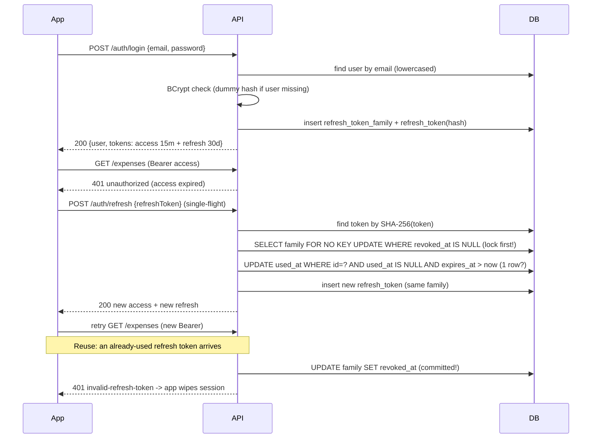

# Authentication flow

Design and reasons: ADR 0002 (refresh tokens), ADR 0008 (family row serializes rotation and
revocation), ADR 0004 (JWT validation), ADR 0006 (audience and strict validation) and ADR 0009
(bcrypt cost, hashing outside the transaction, `lock_timeout`) in
`docs/decisions/`. Endpoints, payloads and errors: `docs/api-contract.md` → Auth.
This skill shows how the API implements them. If real code diverges, the code wins.
Report the divergence so the skill gets updated.

## The flows at a glance



## Schema

**Already implemented** (Increment 2 Step 2): `V1__create_users.sql`, `V2__create_refresh_tokens.sql`.
Read them; this is a summary. Every constraint is named (`pk_`/`uk_`/`ck_`/`fk_`/`idx_`), and
`varchar` + `CHECK` is used instead of `char(n)` (which pads silently).

```sql
-- V1: users
id uuid, name varchar(80), email varchar(254), password_hash varchar(72), currency varchar(3), created_at
  uk_users_email                    unique (email)            -- email is stored lowercase, so plain unique is enough
  ck_users_email_lowercase          email = lower(email)
  ck_users_email_ascii_no_whitespace email ~ '^[!-~]+$'
  ck_users_name_trimmed             name <> '' and name = btrim(name)
  ck_users_name_no_control_chars    no U+0001-U+001F, U+007F-U+009F
  ck_users_password_hash_bcrypt     '^(\{bcrypt\})?\$2[aby]\$[0-9]{2}\$[./A-Za-z0-9]{53}$'  -- plain or Delegating encoder
  ck_users_currency_format          currency ~ '^[A-Z]{3}$'   -- no column default: BRL is applied in RegisterRequest

-- V2: one family row per session (ADR 0008), tokens point to it
refresh_token_families: id, user_id (fk ... on delete cascade, idx), created_at, revoked_at
refresh_tokens:         id, family_id (fk ... on delete cascade, idx), token_hash varchar(64), expires_at, used_at, created_at
  uk_refresh_tokens_token_hash, ck_refresh_tokens_token_hash_hex ('^[0-9a-f]{64}$'),
  ck_refresh_tokens_expires_after_creation
```

No `user_id` and no `revoked_at` on `refresh_tokens`: owner and revocation belong to the family,
so they have one source of truth.

**Email normalization** is lowercase only (`User.normalizeEmail`, `Locale.ROOT`), never strip:
whitespace anywhere is rejected by `@ValidEmail` before it gets there. Register and login use
the same method.

## Configuration: fail fast without a strong secret

**Already implemented**: `shared/security/JwtProperties.java`. Read it; the rules it follows:

- `@Validated` record bound to `app.security.jwt`. Blank secret, non-Base64 or fewer than 32
  decoded bytes, or a non-positive TTL → the application does not start.
- **Never pass the JDK Base64 exception on**, not even as a cause: its message quotes the
  offending character, which is part of the secret ("Illegal base64 character ..."). Catch it
  and throw a generic message.
- `toString()` masks the secret. `JwtProperties.AUDIENCE = "snapledger-api"` is a constant
  (ADR 0006), not a property, so issuing and validating can never disagree.

Same pattern for the refresh token TTL, never `@Value` on a field. **Already implemented**:
`auth/RefreshTokenProperties.java` (`@NotNull Duration ttl`, zero or negative refused at
startup). It lives in `auth/`, not in `shared/security/`, and is **not** registered in
`SecurityConfig`: only the auth feature uses it, and `shared/` never imports from a feature.

Enable with `@ConfigurationPropertiesScan` on the application class. Properties classes
that `@WebMvcTest` slices need must **also** be listed in `@EnableConfigurationProperties` on a
configuration class they import (slices do not run the scan). Boot registers each record once.

## SecurityConfig

**Already implemented**: `shared/security/SecurityConfig.java`. It is the reference; this
section explains it. Never re-create it from memory.

| Piece | What it does | Why |
|---|---|---|
| Chain 1 `@Order(1)` `/api/v1/auth/**` | No resource server. `POST` register/login/refresh/logout `permitAll()`, anything else `denyAll()`. Exception handling: `AuthPathNotFoundHandler` → `404 not-found`, no `WWW-Authenticate` | ADR 0005: a stale `Authorization` header must never break auth endpoints; unlisted paths fail closed without asking for a token |
| Chain 2 `@Order(2)` everything else | Resource server JWT. `/docs/**`, `/v3/api-docs/**` public, rest `authenticated()`. Entry point → `401 unauthorized` + `WWW-Authenticate: Bearer`; denied → `403 forbidden` (set on **both** `exceptionHandling` and `oauth2ResourceServer`, or the resource server's default handler can answer) | ADR 0004 |
| `common(http)` | CSRF off, CORS on, `STATELESS` | No cookies, so no session and no CSRF |
| `JwtDecoder` | HS256 pinned; explicit `DelegatingOAuth2TokenValidator`: `JwtTimestampValidator(5 s)` with the **injected `Clock`**, issuer, `JwtAudienceValidator(AUDIENCE)`, `sub` canonical UUID, `exp` and `iat` required | ADR 0006. Never `JwtValidators.createDefaultWithIssuer`: 60 s skew, system clock, accepts tokens without `exp`/`sub`/`aud` |
| Claim converter `keepIssuedAtAsSent()` | Removes the `iat` that Spring **invents** (`exp - 1 s`) when the token has none **or has `"iat": null`** (Nimbus keeps a null claim as a present key, so the check is `raw.get(IAT) != null`, not `containsKey`) | Without it the "iat required" check can never fail |
| `JwtEncoder` | `NimbusJwtEncoder(new ImmutableSecret<>(key))` | Same key as the decoder; only for access tokens |
| `CorsConfigurationSource` | Origins from `CorsProperties` (exact `http(s)://host[:port]`, no `*`, no `null`); methods GET/POST/PUT/PATCH/DELETE/OPTIONS; headers `Authorization`, `Content-Type`; exposes `Location`, `WWW-Authenticate`; no credentials; max age 1 h | Explicit list; bearer tokens need no cookies |

Never merge the two chains: with one chain, `BearerTokenAuthenticationFilter` rejects an
expired token **before** `permitAll()` is evaluated, and logout/refresh break (ADR 0005).

Domain auth failures (wrong password, invalid refresh token) are `ApiException` subclasses,
**never** Spring's `AuthenticationException`: the global handler rethrows the latter to the
security layer, and on chain 1 that would turn a wrong password into a `404`.

## Current user: the only way to get a user id

```java
@Target(ElementType.PARAMETER)
@Retention(RetentionPolicy.RUNTIME)
@AuthenticationPrincipal(expression = "T(java.util.UUID).fromString(subject)")
public @interface CurrentUserId {}
```

`@AuthenticationPrincipal` works as a meta-annotation. The principal is the validated
`Jwt`, and `subject` is its `sub` claim (the user UUID). Controllers declare
`@CurrentUserId UUID userId` and never accept a user id from the request. The decoder already
guarantees `sub` is a canonical UUID (ADR 0006), so `fromString` cannot fail here.

## Issuing the access token

**Already implemented**: `auth/AccessTokenService.java`. Tokens travel as `IssuedToken(value, ttl)`
(`auth/IssuedToken.java`, `toString` masks the value), never as a bare `String`, so
`TokenResponse.bearer` takes `expiresIn` from the same TTL the token was signed with.

```java
@Service
@RequiredArgsConstructor
public class AccessTokenService {

    private final JwtEncoder encoder;
    private final JwtProperties props;
    private final Clock clock;

    public IssuedToken issue(UUID userId) {
        var now = clock.instant();
        var ttl = props.accessTokenTtl();
        var claims = JwtClaimsSet.builder()
                .issuer(props.issuer())
                .audience(List.of(JwtProperties.AUDIENCE))   // REQUIRED (ADR 0006): without it every token is rejected
                .subject(userId.toString())        // no email, no name: no personal data in the token
                .issuedAt(now)
                .expiresAt(now.plus(ttl))
                .build();
        var header = JwsHeader.with(MacAlgorithm.HS256).build();
        return new IssuedToken(encoder.encode(JwtEncoderParameters.from(header, claims)).getTokenValue(), ttl);
    }
}
```

## Refresh tokens: generate, hash, rotate, detect reuse

**Already implemented** (Increment 3): `auth/RefreshTokenService.java` (`startFamily`, `rotate`,
`revokeFamilyOf`, `issue`, `sha256`, nested `Rotation`). Read it; this is a summary.
`InvalidRefreshTokenException` lives in `shared/error/` like every `ApiException`. A lock wait past
`lock_timeout` (3 s, ADR 0009) is `CannotAcquireLockException`: `rotate` does **not** catch it; it
stays a masked `500`, never `401 invalid-refresh-token`. Why `noRollbackFor` and not `REQUIRES_NEW`,
and why `AuthService.refresh` is never transactional: ADR 0008 amendment.

```java
@Service
@RequiredArgsConstructor
public class RefreshTokenService {

    private static final SecureRandom RANDOM = new SecureRandom();

    private final RefreshTokenRepository tokens;
    private final RefreshTokenFamilyRepository families;
    private final RefreshTokenProperties props;   // record bound to app.security.refresh-token (ttl)
    private final Clock clock;

    /** Login/register: new family. Returns the RAW token, shown to the client once. */
    @Transactional
    public IssuedToken startFamily(UUID userId) {
        var now = clock.instant();
        var family = families.save(RefreshTokenFamily.start(userId, now));
        return issue(family.getId(), now);
    }

    /**
     * noRollbackFor: on reuse we revoke the family and then throw. Without it, the
     * exception would roll back the revocation and the attacker would keep the session.
     */
    @Transactional(noRollbackFor = InvalidRefreshTokenException.class)
    public Rotation rotate(String rawToken) {
        var token = tokens.findByTokenHash(sha256(rawToken))
                .orElseThrow(InvalidRefreshTokenException::new);

        // 1. Lock the family FIRST (ADR 0008). Waits for a concurrent revocation or rotation of the
        //    same session; empty = revoked (or revoked while we waited).
        var family = families.lockActive(token.getFamilyId())
                .orElseThrow(InvalidRefreshTokenException::new);

        // 2. "now" AFTER the lock (a rotation that waited judges expiry when it runs), truncated to
        //    micros (PostgreSQL's precision; pgjdbc rounds nanos, which could fake a reuse).
        //    Expired is NOT reuse: 401, session left alone. Same boundary as markUsed.
        var now = clock.instant().truncatedTo(ChronoUnit.MICROS);
        if (!token.getExpiresAt().isAfter(now)) {
            throw new InvalidRefreshTokenException();
        }
        // 3. Atomic: only one request can consume this token, even if two arrive together.
        if (tokens.markUsed(token.getId(), now) == 0) {
            families.revoke(family.getId(), now);              // reuse => kill the whole session
            log.warn("Refresh token reuse detected; family revoked familyId={}", family.getId()); // ids only
            throw new InvalidRefreshTokenException();
        }
        return new Rotation(family.getUserId(), issue(family.getId(), now));
    }

    /** Logout: idempotent, never reveals whether the token existed. Any known token counts, even used or expired. */
    @Transactional
    public void revokeFamilyOf(String rawToken) {
        tokens.findByTokenHash(sha256(rawToken))
              .ifPresent(t -> families.revoke(t.getFamilyId(), clock.instant()));
    }

    private IssuedToken issue(UUID familyId, Instant now) {
        var bytes = new byte[TOKEN_BYTES];                          // 32 bytes = 256 bits
        RANDOM.nextBytes(bytes);
        var raw = Base64.getUrlEncoder().withoutPadding().encodeToString(bytes);
        var ttl = props.ttl();
        tokens.save(RefreshToken.issue(familyId, sha256(raw), now, now.plus(ttl)));
        return new IssuedToken(raw, ttl);                           // raw: never logged, never stored
    }

    static String sha256(String raw) {
        try {
            var digest = MessageDigest.getInstance("SHA-256").digest(raw.getBytes(StandardCharsets.UTF_8));
            return HexFormat.of().formatHex(digest);
        } catch (NoSuchAlgorithmException e) {
            throw new IllegalStateException(e);                     // SHA-256 is mandatory in every JVM
        }
    }

    public record Rotation(UUID userId, IssuedToken refreshToken) {}
}
```

The repositories **already exist** (`auth/RefreshTokenRepository.java`,
`auth/RefreshTokenFamilyRepository.java`); read their Javadoc. Their primitives:

| Method | SQL shape | Returns |
|---|---|---|
| `findByTokenHash(hash)` | lookup by unique index | `Optional<RefreshToken>` |
| `RefreshTokenFamilyRepository.lockActive(id)` | `@Lock(PESSIMISTIC_WRITE)` → `select ... where id = ? and revoked_at is null for no key update` | `Optional<RefreshTokenFamily>` (has `userId`) |
| `markUsed(id, now)` | `update ... set used_at where id = ? and used_at is null and expires_at > now and exists(active family)` | rows changed (0/1) |
| `RefreshTokenFamilyRepository.revoke(id, now)` | `update ... set revoked_at where id = ? and revoked_at is null` | rows changed (0/1) |

Every `@Modifying` here uses `flushAutomatically = true, clearAutomatically = true`: pending inserts
are written before the update, and entities loaded earlier are dropped so nobody reads a stale
`usedAt`/`revokedAt`.

Why the conditional `UPDATE` and not "read `usedAt`, then save"? Two requests can read
`usedAt = null` at the same time and both succeed. The database executes the conditional
update once: the second request sees `0` rows.

Why lock the family first? Under READ COMMITTED a revocation cannot see a token that a still-open
rotation inserted; with the family row locked by both flows they serialize (ADR 0008). Always
**family, then tokens**, so the flows cannot deadlock.

## Register and login (`AuthService`)

**Already implemented**: `auth/AuthService.java`. `AuthService` reaches users only through
**`UserService`** (a feature calls another feature's Service, never its Repository) and never sees
the `User` entity: `UserService.create` returns a `UserResponse`, `UserService.findCredentials`
returns an `Optional<UserCredentials>` (profile + hash, `toString` masks the hash). `UserService`
normalizes the email with `User.normalizeEmail` (lowercase only; `@ValidEmail` already rejected
whitespace). Neither method is `@Transactional` (ADR 0009): bcrypt never runs while a pool
connection is held.

```java
// Built in the constructor: this.transaction = new TransactionTemplate(transactionManager);
public AuthResponse register(RegisterRequest request) {
    var passwordHash = passwordEncoder.encode(request.password());   // BEFORE the transaction opens
    return transaction.execute(status -> startSession(                // ONE transaction: atomic (contract)
            users.create(request.name(), request.email(), passwordHash, request.currency())));
}

public AuthResponse login(LoginRequest request) {                     // no outer transaction
    var account = users.findCredentials(request.email());             // its own read-only transaction
    // Always run BCrypt, so "unknown email" and "wrong password" take similar time.
    var hash = account.map(UserCredentials::passwordHash).orElse(dummyHash);
    var matches = passwordEncoder.matches(request.password(), hash);
    if (account.isEmpty() || !matches) {
        throw new InvalidCredentialsException();                       // same 401 for both cases
    }
    return startSession(account.get().user());
}

private AuthResponse startSession(UserResponse user) {
    var refresh = refreshTokens.startFamily(user.id());               // joins register's transaction
    var access = accessTokens.issue(user.id());
    return new AuthResponse(user,
            TokenResponse.bearer(access.value(), access.ttl(), refresh.value(), refresh.ttl()));
}
```

- `dummyHash` is computed once at startup with the same `passwordEncoder` (same cost).
- **Taken email = `409` by the exact constraint**, never by an exists-query: `UserService.create`
  calls `saveAndFlush` and, on `DataIntegrityViolationException`, asks
  `ConstraintViolations.violates(e, "uk_users_email")` (`shared/error/`, exact name read from
  Hibernate's parsed field, never the message). Yes → `EmailAlreadyRegisteredException` (no cause);
  anything else propagates to the masked `500`.
- The controller answers with `Cache-Control: no-store` and `Pragma: no-cache` (contract, RFC 6749
  §5.1); register is `201` without `Location`.
- A `TransactionTemplate` is the exception, not the pattern: other services keep `@Transactional`.

## Refresh and logout (`AuthService`, `AuthController`)

**Already implemented** (Increment 3). Body `RefreshRequest(@NotBlank @CodePointLength(max = 256)
String refreshToken)`, masked `toString`, no other format rule.

```java
// NEVER @Transactional and no TransactionTemplate: an outer transaction would roll back
// rotate's reuse revocation (ADR 0008 amendment). Signing after rotate commits is accepted.
public TokenResponse refresh(RefreshRequest request) {
    var rotation = refreshTokens.rotate(request.refreshToken());
    var access = accessTokens.issue(rotation.userId());          // owner of the locked family
    var refresh = rotation.refreshToken();
    return TokenResponse.bearer(access.value(), access.ttl(), refresh.value(), refresh.ttl());
}

public void logout(RefreshRequest request) {
    refreshTokens.revokeFamilyOf(request.refreshToken());
}
```

The controller answers refresh `200` with a bare `TokenResponse` plus `no-store`/`no-cache`, and
logout `204` (`@ResponseStatus(NO_CONTENT)`). A lock timeout on either is a masked `500`, the one
exception to "logout always 204" (contract edge cases).

## Tests that must exist

| Test | Proves |
|---|---|
| Startup fails without or with a short `JWT_SECRET` | Fail-fast config |
| Expired, tampered, wrong-issuer and `alg: none` tokens → `401` ProblemDetail | Decoder validators |
| Login: unknown email and wrong password return identical bodies | No enumeration |
| Refresh returns a new pair; the old token then fails | Rotation — *done in Increment 3* (`AuthSessionIntegrationTest`) |
| Reusing an old token revokes the family; the **newest** token also fails afterwards | Reuse detection survives rollback — *done in Increment 3* (`RefreshTokenServiceIntegrationTest`, `AuthSessionIntegrationTest`) |
| Two concurrent refreshes with the same token: exactly one succeeds | Atomic `markUsed` — *done in Increment 3* (service and HTTP level) |
| Logout with unknown token → `204`; after logout, refresh fails | Idempotent revocation — *done in Increment 3* (`AuthSessionIntegrationTest`) |
| An **expired** token → `401`, and the family stays active (another token of it still rotates) | Expiry is not reuse — *done in Increment 3* (`RefreshTokenServiceIntegrationTest`) |
| Revocation while a rotation is open waits, and the token that rotation issued is dead afterwards; a rotation waiting on a revocation gets `401` | Family row serializes (ADR 0008) — repository level *done in Step 2* (`RefreshTokenFamilyRepositoryTest`), service level *done in Increment 3* (`RefreshTokenServiceIntegrationTest`) |
| Logout and refresh succeed with an expired or garbage `Authorization` header; `/users/me` still rejects it | Separate auth chain (ADR 0005) — *done in Increment 3* (`AuthSessionIntegrationTest`, `AuthControllerTest`) |
| Refresh/logout blocked past `lock_timeout` → masked `500`, never `401`; the token still works afterwards | Lock timeout is not a domain error (ADR 0009) — *done in Increment 3* |
| No raw token or hash in the logs; the reuse `WARN` has only the family id | Security rule 8 — *done in Increment 3* (`AuthSessionIntegrationTest`) |
| Unlisted auth path or wrong method (`GET /auth/login`) → `404` without `WWW-Authenticate` | Chain 1 fails closed (ADR 0005) — *done in Increment 1* |
| Tokens missing `exp`, `iat`, `sub` or `aud`, `"iat": null`, wrong `aud`, non-UUID `sub`, expired by > 5 s → `401`; expired by < 5 s → accepted | Strict validation (ADR 0006) — *done in Increment 1* |
| A token from `AccessTokenService` is accepted by `/users/me` | Issuing and validating agree (`aud`, `iss`, claims) |
| Register rejects a password over 72 UTF-8 bytes even when it has fewer than 72 characters | Byte limit matches bcrypt |
| `toString()` of `LoginRequest`, `RegisterRequest`, `RefreshRequest`, `JwtProperties` contains no secret | Masking |

Reuse and concurrency tests need a real database: `@SpringBootTest` + Testcontainers, always with
`@AutoConfigureMockMvc`, never `RANDOM_PORT`/`DEFINED_PORT`: only `ContainerErrorDispatchIntegrationTest`
may start a real server; a second embedded Tomcat in the same JVM is named `Tomcat-1` and escapes
the `[Tomcat]` logger pin (ADR 0007, hook rule A11). Shared helpers (`LockWaits.await`,
`LockWaits.awaitOneBlockedTransaction`, `TestTokenHashes.hashOf`) live in `support/`.

## Client contract (implemented in the app phase)

- Store tokens only in `flutter_secure_storage`.
- On `401 unauthorized` from a non-`/auth/*` endpoint: start **one** refresh. Other failing
  requests wait for it (single-flight), then retry once with the new access token.
- On `401 invalid-refresh-token` or a failed retry: wipe stored tokens and in-memory user
  state, then route to login.
- Logout: call `/auth/logout` (best effort, short timeout), then wipe locally regardless of the result.
- Never log tokens, passwords or `Authorization` headers.
