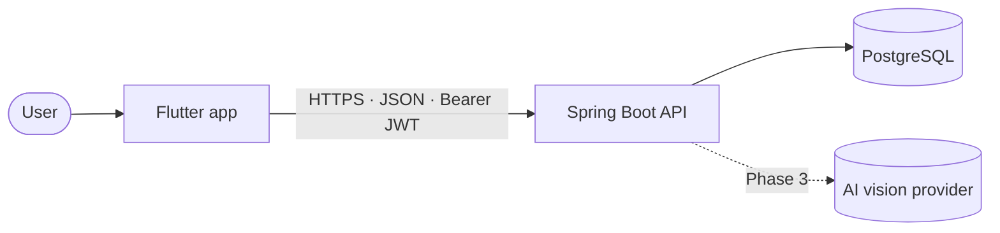

# SnapLedger

**A personal expense tracker built like a production system.**
Flutter app (iOS · Android · Web) + Spring Boot API, with secure token rotation,
contract-first design and AI receipt scanning on the roadmap.

> 🚧 **Status:** work in progress. Phase 0 (foundation) is complete; Phase 1
> (authentication) is next. See the [roadmap](docs/roadmap.md).

## What it does

- **Sign up and stay signed in**: short-lived access tokens with silent, secure renewal.
- **Record expenses** with an amount, date, description and category.
- **Categories**: sensible defaults plus your own.
- **Monthly summary**: total, comparison with last month and a per-category chart.
- **Scan a receipt** *(Phase 3)*: take a photo and get a pre-filled expense to confirm.

## Tech stack

| Layer | Technology |
|---|---|
| App | Flutter, Dart, Provider (ChangeNotifier), GoRouter, Dio, flutter_secure_storage |
| API | Java 21, Spring Boot 4, Spring Security (OAuth2 Resource Server, JWT), Spring Data JPA, MapStruct, Bean Validation |
| Database | PostgreSQL 17, Flyway migrations |
| API docs | OpenAPI via springdoc at `/docs` |
| Tests | JUnit 5, Mockito, Testcontainers · flutter_test |
| Tooling | Docker Compose, Maven wrapper, GitHub Actions *(Phase 4)* |

## Engineering highlights

- **Contract-first API.** [`docs/api-contract.md`](docs/api-contract.md) defines every route,
  payload and error before code exists. Errors follow RFC 9457 (Problem Details).
- **Secure sessions.** 15-minute JWTs plus opaque refresh tokens that are stored hashed,
  rotated on every use and **revoke the whole session when reuse is detected**
  ([ADR 0002](docs/decisions/0002-refresh-token-rotation.md)).
- **No IDOR by design.** The user id comes only from the token, every query is scoped by it,
  and another user's data returns `404`, indistinguishable from "not found".
- **Money done right.** `numeric(12,2)` → `BigDecimal` → decimal strings in JSON. No floats anywhere.
- **Secrets stay secret.** Configuration only through environment variables; the API refuses
  to start without a strong signing key; the AI key never reaches the client
  ([ADR 0003](docs/decisions/0003-ai-key-backend-only.md)).
- **Clean layering.** API organized by feature (controller → service → repository); app in
  MVVMC (View → Controller → ViewModel → Repository → Model).
- **Real database in tests.** Testcontainers runs PostgreSQL, so migrations and queries are
  tested exactly as in production.
- **Decisions are documented.** Architecture Decision Records in [`docs/decisions/`](docs/decisions/).

## Architecture



More diagrams (containers, layers, request lifecycle, data model) in
[`docs/architecture.md`](docs/architecture.md).

## Getting started

**Prerequisites:** Java 21, Docker, Flutter (stable).

```bash
git clone https://github.com/YuleHohenfeld/snapledger.git && cd snapledger

# 1. Environment
cp .env.example .env
#    fill POSTGRES_PASSWORD (openssl rand -base64 24)
#    and JWT_SECRET       (openssl rand -base64 64)

# 2. Database
docker compose up -d

# 3. API → http://localhost:8080
cd api && ./mvnw spring-boot:run

# 4. App (new terminal)
cd app && flutter pub get
flutter run --dart-define=API_BASE_URL=http://localhost:8080
#    Android emulator: use http://10.0.2.2:8080
#    Web: flutter run -d chrome --web-port 8081 (matches CORS_ALLOWED_ORIGINS)
```

Run the tests:

```bash
cd api && ./mvnw test          # needs Docker for Testcontainers
cd app && flutter test
```

## Project structure

```
snapledger/
├── app/                 Flutter app (MVVMC, by feature → screen → layer)
├── api/                 Spring Boot API (by feature: auth, user, category, expense, shared)
├── docs/
│   ├── api-contract.md  API v1: routes, payloads, errors
│   ├── architecture.md  C4 diagrams, layers, data model
│   ├── roadmap.md       Phases and done criteria
│   └── decisions/       Architecture Decision Records
├── .claude/, scripts/   AI-assisted development guardrails (see below)
├── docker-compose.yml   Local PostgreSQL 17
└── .env.example         Environment variables template
```

## AI-assisted development, with guardrails

This project is built with [Claude Code](https://claude.com/claude-code) as a pair programmer,
under explicit engineering rules rather than free-form generation:

- **Written rules** for the whole repo and per folder (`CLAUDE.md`, `api/CLAUDE.md`).
- **Specialized agents** (`.claude/agents/`): a planner that only plans, an implementer that
  follows an approved plan, and read-only reviewers for architecture and security.
- **Automatic checks** (`scripts/claude/`): hooks that reject rule violations right after an
  edit (field injection, CORS wildcards, floats for money, user ids from requests...), compile
  the API and require a security review when authentication code changes.
- **Every plan is approved and every commit is reviewed by me** before it reaches the repository.

## Roadmap

| Phase | Scope | Status |
|---|---|---|
| 0 | Foundation: contract, ADRs, tooling | ✅ Done |
| 1 | Authentication (API + app) | ⏳ Next |
| 2 | Expenses, categories, monthly summary | Planned |
| 3 | AI receipt scanning | Planned |
| 4 | CI, coverage, rate limiting, deploy, live demo | Planned |

Details in [`docs/roadmap.md`](docs/roadmap.md).

## Author

**Yule Hohenfeld** · [LinkedIn](https://www.linkedin.com/in/yule-hohenfeld-b016242ba/) · [GitHub](https://github.com/YuleHohenfeld)

## License

[MIT](LICENSE) © 2026 Yule Hohenfeld
