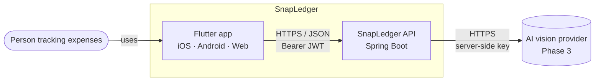
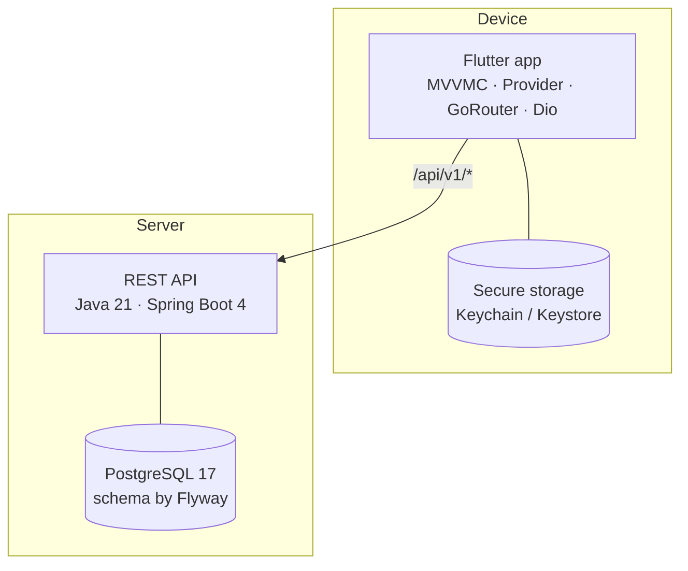
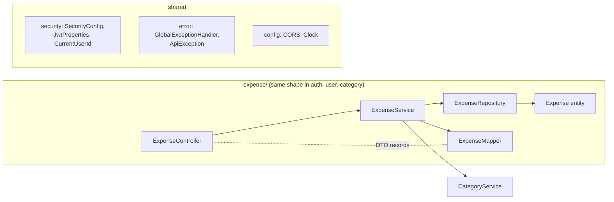
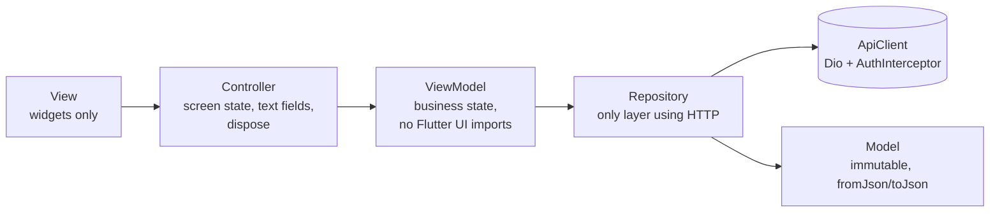
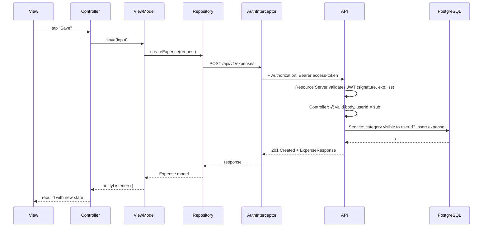
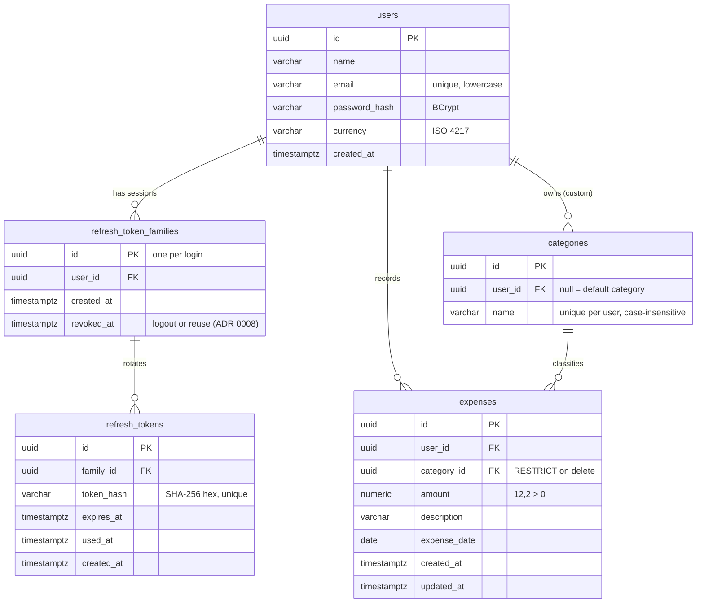

# Architecture

How the pieces of SnapLedger fit together. For **what** the API does, see
[`api-contract.md`](api-contract.md); for **why** decisions were made, see [`decisions/`](decisions/).
Diagrams follow the [C4 model](https://c4model.com/) and are written in Mermaid, so GitHub
renders them and they are versioned with the code.

## 1. System context



The person only talks to the app. The app only talks to the API. Only the API talks to the
AI provider, so the AI key never leaves the server ([ADR 0003](decisions/0003-ai-key-backend-only.md)).

## 2. Containers



| Container | Responsibility | Key technology |
|---|---|---|
| Flutter app | UI, local session, calling the API | Provider + ChangeNotifier, GoRouter, Dio, flutter_secure_storage |
| REST API | Business rules, authentication, authorization, persistence | Spring Web MVC, Spring Security (Resource Server), Spring Data JPA, MapStruct |
| PostgreSQL | Users, refresh tokens, categories, expenses | Flyway migrations, `ddl-auto=validate` |

Both run locally with `docker compose up -d` (database) plus `./mvnw spring-boot:run` and
`flutter run`. The repository layout is described in [ADR 0001](decisions/0001-monorepo.md).

## 3. API inside

Package by feature. Each feature owns its layers; `shared/` holds cross-cutting code.



| Layer | Does | Never does |
|---|---|---|
| Controller | Maps HTTP, triggers validation, reads the user id from the token | Business rules, `try/catch`, repositories, entities |
| Service | Rules, transactions, ownership through scoped queries | HTTP concerns |
| Repository | Queries, always with `userId` for user data | String-built SQL |
| Entity | Table mapping, invariants through methods | Setters, `@Data` |
| DTO / Mapper | Contract shapes, conversion | Expose internal fields |

A feature may call another feature's **service**, never its repository. Full rules:
[`api/CLAUDE.md`](../api/CLAUDE.md).

## 4. App inside (overview)

MVVMC with a strict one-way flow, organized by feature, then by screen, then by layer.
Detailed rules arrive with `app/CLAUDE.md` in the app phase.



```
app/lib/
├── core/            ApiClient, AuthInterceptor, session, router, design system
└── features/
    └── expenses/
        ├── _shared/data/          models + repository used by 2+ screens
        ├── list/                  application/{controller,viewmodel} + presentation/
        └── form/                  application/{controller,viewmodel} + presentation/
```

- Navigation: GoRouter with a `redirect` driven by the session state; bottom navigation with
  three tabs: **Summary**, **Expenses**, **Profile**.
- Configuration: `API_BASE_URL` via `--dart-define`; no secrets in the app.
- Session: tokens in `flutter_secure_storage`; one refresh at a time; wipe on failure.

## 5. An authenticated request, step by step



If the access token expired, the API answers `401 unauthorized`; the interceptor runs a single
refresh, retries once, and wipes the session if the refresh fails
([ADR 0002](decisions/0002-refresh-token-rotation.md), `auth-flow` skill).

## 6. Data model



Money is `numeric(12,2)` in the database, `BigDecimal` in Java and a decimal **string** in JSON.

## 7. Security overview

| Concern | How it is handled | Reference |
|---|---|---|
| Identity | JWT access token (15 min, HS256) validated by Spring's Resource Server | ADR 0004 |
| Long sessions | Opaque refresh token (30 days), stored hashed, rotated, reuse revokes the family | ADR 0002 |
| Authorization | User id only from the token; every query scoped by `userId`; others' data → `404` | `api/CLAUDE.md` |
| Secrets | Environment variables only; app fails to start without `JWT_SECRET` | `.env.example` |
| Browser access | CORS with an explicit origin list | `CORS_ALLOWED_ORIGINS` |
| Errors | RFC 9457 ProblemDetail, no internals leaked | `api-contract.md` → Errors |
| Device storage | Tokens in Keychain/Keystore via `flutter_secure_storage` | App phase |
| AI provider | Key only in the backend; uploads validated; images not stored | ADR 0003 |

## 8. Testing strategy

| Level | API | App |
|---|---|---|
| Unit | Services with Mockito and a fixed `Clock` | ViewModels and Controllers with fake repositories |
| Slice | `@WebMvcTest` for controllers (status, JSON, ProblemDetail) | Widget tests for key screens |
| Integration | `@DataJpaTest` and `@SpringBootTest` with Testcontainers PostgreSQL | Interceptor with a mocked HTTP adapter |
| End to end | Auth flow against a running API (Phase 4) | — |

Real PostgreSQL in tests (never H2) means migrations and queries are tested exactly as they
run in production.
